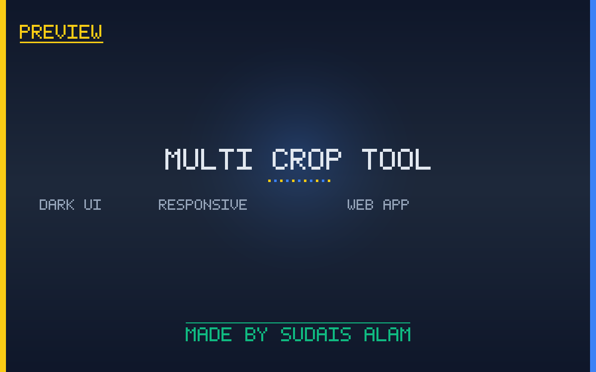

# Multi-Crop Tool

A single-file, browser-based image cropper that lets you upload **one image** and instantly preview & export perfectly sized crops for every major social media platform at once. Built as a self-contained HTML page — no backend, no installs.



---

## Features

- **One upload, every platform** — preview all crops side-by-side in real time.
- **Built-in platform presets**
  - Instagram Post (1:1)
  - Instagram Story (9:16)
  - YouTube Thumbnail (16:9)
  - LinkedIn Post
  - Twitter Header (2:1)
  - Pinterest Pin (1:2)
  - TikTok Video (9:16)
  - Facebook Cover (4:5)
- **Smart Auto-Crop** — AI-assisted subject detection keeps faces/subjects inside the safe zone.
- **Custom aspect ratios** — define and reuse your own ratios for any platform.
- **Drag & drop upload** with hover/dragover states.
- **Filters & adjustments** — apply quick filters before exporting.
- **Download all crops as a ZIP** — uses JSZip, one click exports every platform crop.
- **Real-time collaboration panel** placeholder for team workflows.
- **Responsive UI** with Poppins typography and Font Awesome icons.

---

## Tech Stack

| Layer        | Technology |
|--------------|------------|
| Markup       | Single `multicrop.html` (HTML5) |
| Styling      | Custom CSS, CSS variables, gradients |
| Fonts/Icons  | Google Fonts (Poppins), Font Awesome 6 |
| Image work   | HTML5 Canvas API |
| ZIP export   | JSZip 3.7.1 (CDN) |
| Dependencies | All via CDN — no build step |

---

## How to Use

1. Open `multicrop.html` in any modern browser (double-click, or serve locally).
2. Click **Upload Image Now** (or drag & drop an image onto the upload area).
3. Adjust the crop / drag the image inside each platform preview if needed.
4. (Optional) Use **Smart Auto-Crop** or apply a filter.
5. Click the per-platform **Download** button, or download **all crops as a ZIP**.

---

## Project Structure

```
multi-crop-in-one/
├── multicrop.html          # The entire app (markup + CSS + JS)
├── README.md
├── SETUP.md
└── preview/preview.png
```

---

## Documentation

- [SETUP.md](SETUP.md) — how to run, host, and customize the tool.

---

## Credits

Made by **Sudais Alam**.
